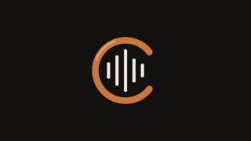

# Cobre TV



Aplicativo em **protótipo — versão 0.5.0** para Android TV e Google TV. A TV entra no Cobre ID, encontra computadores automaticamente na rede local ou usa o endereço manual, pede autorização por aparelho e carrega a biblioteca real. Com a aprovação no Desktop, reproduz o áudio diretamente pela rede local e informa presença e métricas agregadas de stream ao Cobre Server.

## O que existe hoje

- Manifesto para Android TV, navegação por controle remoto e banner de início.
- Interface para controle remoto com grade da biblioteca real, capas/metadados carregados do Desktop e barra de reprodução.
- Media3 ExoPlayer reproduz as faixas do álbum selecionado, com fila do álbum e controles anterior, pausar/tocar e próxima.
- Ícone e banner Cobre incluídos nos recursos do Android.
- Configuração do endereço do Cobre Server, limitada a HTTPS ou IPv4 privado quando usar HTTP local.
- Pareamento Cobre ID: solicita código curto à API, apresenta-o na TV, aguarda aprovação autenticada em outro Cobre e resgata uma única sessão.
- Lista os Desktops registrados na conta, permite informar o endereço local e solicita escopos de biblioteca, streaming e controle. O Desktop precisa aprovar a TV.
- Tokens de sessão e concessão ficam cifrados com uma chave vinculada ao Android Keystore; as concessões curtas são renovadas durante o uso.
- O áudio é entregue pelo Desktop diretamente à TV usando autorização no cabeçalho e suporte do host a HTTP Range. O Cobre Server só coordena conta, presença e consentimento.
- Enquanto o app está aberto, presença é enviada periodicamente ao Cobre Server. A TV reporta latência inicial e taxa recebida somente para streams do Desktop, sem enviar nomes ou conteúdo das faixas.
- HTTP é limitado a IPv4 privado da rede local; HTTPS depende de certificado aceito pelo Android.

## O que falta para ser utilizável

- Validar a descoberta local, pareamento, autorização, capas, reprodução, troca de faixa e renovação de tokens em Android TV/Google TV físico. A busca mDNS requer Desktop 3.13.0 ou posterior.
- Adicionar retomada após troca de rede, sincronização de estado e navegação detalhada por faixa.
- Testar o fluxo com instalações reais do Cobre Server, Desktop e Mobile; compilação sozinha não comprova a conexão entre aparelhos.
- Criar assinatura estável e release instalável depois de validar a migração e a atualização em uma TV real.

## Compilar

Requer JDK 17 e Android SDK com plataforma 34. No Windows:

```powershell
.\gradlew.bat :app:assembleDebug
```

O APK de depuração aparece em `app/build/outputs/apk/debug/app-debug.apk`. Esse APK não é uma release assinada para distribuição.

## Versões e créditos

Consulte [`CHANGELOG.md`](CHANGELOG.md) para as notas da versão e [`docs/REGISTRO-DE-TRABALHO.md`](docs/REGISTRO-DE-TRABALHO.md) para validações e pendências. Projeto de Bruno C S Moraes, com contribuições de [@dilucas00](https://github.com/dilucas00).
